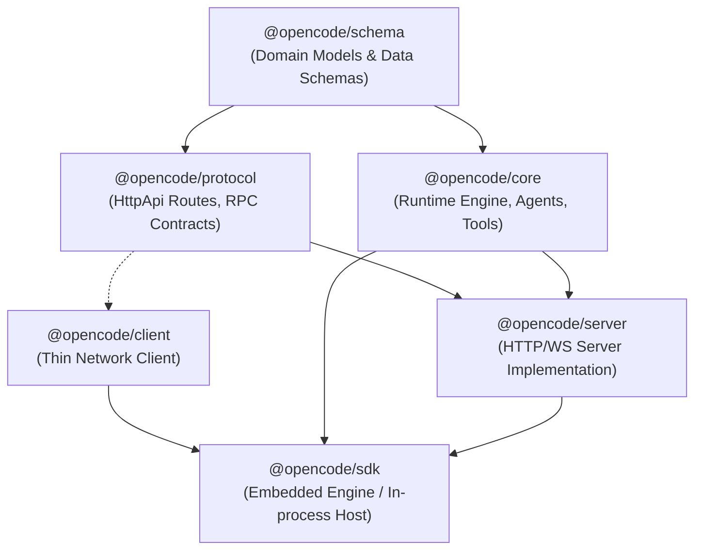
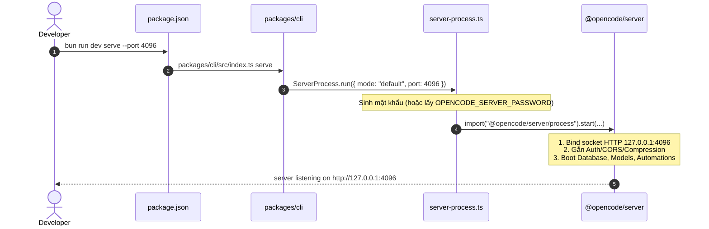

# Tài liệu Kiến trúc, Sử dụng Local & Triển khai OpenCode trên VPS

Tài liệu này cung cấp toàn bộ kiến thức kỹ thuật về kiến trúc module hóa của OpenCode, cơ chế giao thức và kết nối, hướng dẫn chạy máy chủ và các ứng dụng trên môi trường Local, cùng quy trình chuẩn để triển khai trên máy chủ đám mây / VPS hoạt động 24/7 với chứng chỉ bảo mật HTTPS.

---

## Phần 1: Kiến trúc Tầng Giao thức & Kết nối

### 1. Phân tầng trách nhiệm các gói chính

Hệ thống OpenCode tuân thủ quy tắc phụ thuộc một chiều nghiêm ngặt:
$$\text{Schema} \longrightarrow \text{Core} \ \& \ \text{Protocol} \longrightarrow \text{Server} \longrightarrow \text{SDK}$$



* **`@opencode/schema`**: Là tầng gốc dữ liệu thuần túy (*Single Source of Truth*), chứa định nghĩa types, Effect Schemas và Drizzle ORM entities. Không phụ thuộc transport layer.
* **`@opencode/protocol`**: Đặc tả giao thức API giữa Client và Server sử dụng Effect `HttpApi` (endpoints, input/output schemas, error contracts).
* **`@opencode/server`**: Triển khai nghiệp vụ của backend, tiếp nhận request và điều phối session, database, AI model providers.
* **`@opencode/client`**: Client mạng siêu nhẹ (*Thin Client*), chỉ phụ thuộc vào `schema` và `protocol`. Dùng để giao tiếp với Server qua HTTP/SSE/WebSocket từ trình duyệt, frontend UI hoặc CLI.
* **`@opencode/sdk`**: Bộ công cụ nhúng cấp cao (*Fat SDK*). Tự khởi tạo một `EmbeddedHost` chạy ngầm trong bộ nhớ và kết nối `client` qua in-memory fetch mà không cần mở socket mạng thực tế.

---

## Phần 2: Hướng dẫn Chạy & Sử dụng trên Máy Local

Bạn có thể chạy OpenCode trên máy tính cá nhân (macOS, Linux, Windows) theo nhiều chế độ khác nhau tùy vào nhu cầu công việc.

### 1. Chuẩn bị môi trường Local
* Cài đặt **Bun** (phiên bản khuyến nghị $\ge 1.4.x$):
  ```bash
  # macOS / Linux
  curl -fsSL https://bun.sh/install | bash
  source ~/.bashrc # hoặc ~/.zshrc
  ```
* Thiết lập API Key cho các mô hình AI (thêm vào `~/.zshrc` hoặc `~/.bashrc`):
  ```bash
  export ANTHROPIC_API_KEY="sk-ant-..."
  export OPENAI_API_KEY="sk-..."
  export GEMINI_API_KEY="AIzaSy..."
  ```

---

### 2. Các chế độ chạy trên Local

#### Chế độ A: Giao diện Terminal tương tác (TUI - Khuyên dùng khi code)
Chạy AI agent trực tiếp trên terminal trong thư mục dự án của bạn:
```bash
# Chạy từ mã nguồn repo:
bun run dev

# Hoặc nếu đã cài đặt CLI toàn cục:
opencode
```
* Phím `Tab`: Chuyển đổi giữa agent **build** (lập trình, sửa file) và **plan** (phân tích, lên kế hoạch).
* Phím `Ctrl + P`: Mở danh sách các phiên làm việc (sessions).
* Phím `Ctrl + C`: Ngắt hoặc hủy tác vụ đang xử lý.

---

#### Chế độ B: Chạy Server & Dùng Web UI trên trình duyệt
Nếu bạn muốn sử dụng giao diện web trực quan trên máy tính:
```bash
# 1. Khởi động server với password và port tự chọn
OPENCODE_SERVER_PASSWORD="opencode-dev-token" bun run dev serve --port 4096
```
* Mở trình duyệt truy cập: [http://127.0.0.1:4096](http://127.0.0.1:4096)
* Nhập mật khẩu: `opencode-dev-token` để bắt đầu sử dụng giao diện Web UI.

---

#### Chế độ C: Chạy ứng dụng Desktop (Electron App)
Nếu bạn muốn phát triển hoặc dùng OpenCode dưới dạng cửa sổ Desktop độc lập:
```bash
bun run dev:desktop
```
Lệnh này sẽ khởi động ứng dụng Electron và kết nối với server backend cục bộ.

---

#### Chế độ D: Quản lý Background Service (Dịch vụ chạy ngầm)
OpenCode có chế độ daemon ngầm giúp quản lý các terminal PTY và phiên làm việc bền vững qua các lần khởi động lại:
```bash
# Bật dịch vụ chạy ngầm:
bun run dev service start

# Kiểm tra trạng thái và URL dịch vụ:
bun run dev service status

# Lấy mật khẩu dịch vụ để đăng nhập:
bun run dev service get password

# Dừng dịch vụ ngầm:
bun run dev service stop
```

---

#### Chế độ E: Kiểm thử & Live Development
* **Kiểm tra linter và typecheck toàn dự án:**
  ```bash
  bun run check
  ```
* **Chạy TUI kết nối live với daemon server hiện tại:**
  ```bash
  bun run dev:live
  ```

---

## Phần 3: Khởi chạy Server từ Source Code (Cơ chế hoạt động)

### 1. Luồng hoạt động (`bun run dev serve`)



### 2. Các lệnh khởi chạy thủ công

```bash
# Đặt mật khẩu và port cố định:
OPENCODE_SERVER_PASSWORD="your-strong-password" bun run dev serve --port 4096

# Hoặc gọi trực tiếp file CLI entrypoint:
OPENCODE_SERVER_PASSWORD="your-strong-password" bun run --cwd packages/cli src/index.ts serve --port 4096
```

---

## Phần 4: Hướng dẫn Triển khai Production trên VPS Linux

Áp dụng cho hệ điều hành **Ubuntu 22.04 / 24.04 LTS** hoặc **Debian 11 / 12**.

### 1. Cài đặt môi trường cần thiết
```bash
# Cập nhật hệ thống
sudo apt update && sudo apt upgrade -y
sudo apt install -y curl git ufw

# Cài đặt Bun Runtime
curl -fsSL https://bun.sh/install | bash
source ~/.bashrc
```

### 2. Tải và build mã nguồn OpenCode
```bash
cd /opt
sudo git clone https://github.com/anomalyco/opencode.git
cd opencode
sudo chown -R $USER:$USER /opt/opencode

# Cài đặt toàn bộ dependencies
bun install
```

### 3. Cấu hình biến môi trường an toàn
Tạo thư mục cấu hình và đặt quyền truy cập chỉ định:
```bash
sudo mkdir -p /etc/opencode
sudo bash -c 'cat << "EOF" > /etc/opencode/opencode.env
# Mật khẩu kết nối vào Server
OPENCODE_SERVER_PASSWORD=SuperSecretPassword_ChangeMe_2026

# Khóa API các dịch vụ AI
ANTHROPIC_API_KEY=sk-ant-...
OPENAI_API_KEY=sk-...
GEMINI_API_KEY=AIzaSy...
EOF'

sudo chmod 600 /etc/opencode/opencode.env
```

### 4. Thiết lập Systemd Service (Chạy nền 24/7 & Tự hồi sinh)
Tạo file dịch vụ systemd:
```bash
sudo bash -c 'cat << "EOF" > /etc/systemd/system/opencode.service
[Unit]
Description=OpenCode Production Server
After=network.target

[Service]
Type=simple
User=root
WorkingDirectory=/opt/opencode
EnvironmentFile=/etc/opencode/opencode.env
ExecStart=/root/.bun/bin/bun run dev serve --port 4096 --hostname 127.0.0.1
Restart=always
RestartSec=5
LimitNOFILE=65536

[Install]
WantedBy=multi-user.target
EOF'

# Kích hoạt và bật service
sudo systemctl daemon-reload
sudo systemctl enable opencode
sudo systemctl start opencode
```

Kiểm tra trạng thái service:
```bash
sudo systemctl status opencode
```

---

## Phần 5: Cấu hình HTTPS Tự động qua Reverse Proxy (Caddy)

Caddy là reverse proxy hiện đại, nhẹ, bảo mật cao và tự động đăng ký, gia hạn chứng chỉ SSL Let's Encrypt hoàn toàn tự động.

### 1. Cài đặt Caddy
```bash
sudo apt install -y debian-keyring debian-archive-keyring apt-transport-https curl
curl -1sLf 'https://dl.cloudsmith.io/public/caddy/stable/gpg.key' | sudo gpg --dearmor -o /usr/share/keyrings/caddy-stable-archive-keyring.gpg
curl -1sLf 'https://dl.cloudsmith.io/public/caddy/stable/debian.deb.txt' | sudo tee /etc/apt/sources.list.d/caddy-stable.list
sudo apt update
sudo apt install caddy -y
```

### 2. Thiết lập Caddyfile
Trỏ bản ghi DNS `A` của tên miền về IP của VPS (ví dụ: `opencode.yourdomain.com`). Sau đó chỉnh sửa `/etc/caddy/Caddyfile`:

```caddyfile
opencode.yourdomain.com {
    reverse_proxy 127.0.0.1:4096 {
        # Đảm bảo WebSocket và Server-Sent Events (SSE) hoạt động mượt mà
        header_up Host {host}
        header_up X-Real-IP {remote_host}
    }
}
```

Khởi động lại Caddy để áp dụng:
```bash
sudo systemctl restart caddy
```

### 3. Cấu hình Tường lửa (Firewall UFW)
```bash
sudo ufw allow 22/tcp
sudo ufw allow 80/tcp
sudo ufw allow 443/tcp
sudo ufw enable
```

> [!IMPORTANT]
> Cổng `4096` của OpenCode được ràng buộc nội bộ tại `127.0.0.1`, chỉ có Caddy mới có quyền giao tiếp và đóng gói HTTPS ra internet qua cổng `443`. Điều này giúp hệ thống miễn nhiễm với các cuộc quét cổng công khai.

---

## Phần 6: Cách Kết nối & Tương tác từ xa

### 1. Truy cập qua Trình duyệt Web (Web UI)
* Mở trình duyệt truy cập: `https://opencode.yourdomain.com`
* Nhập mật khẩu đã đặt tại biến `OPENCODE_SERVER_PASSWORD` để đăng nhập vào Web UI.

### 2. Kết nối bằng CLI từ máy tính cá nhân
Trên máy tính phát triển (Mac/Linux/Windows), bạn kết nối thẳng vào VPS:
```bash
OPENCODE_SERVER_PASSWORD="SuperSecretPassword_ChangeMe_2026" opencode --server https://opencode.yourdomain.com
```

### 3. Lập trình điều khiển qua `@opencode/client` TypeScript SDK

```typescript
import { OpenCode } from "@opencode/client"

const SERVER_URL = "https://opencode.yourdomain.com"
const PASSWORD = "SuperSecretPassword_ChangeMe_2026"

// Khởi tạo client với HTTP Basic Auth
const client = OpenCode.make({
  baseUrl: SERVER_URL,
  headers: {
    Authorization: `Basic ${btoa(`opencode:${PASSWORD}`)}`,
  },
})

async function runTask() {
  // 1. Kiểm tra trạng thái máy chủ
  const info = await client.server.info()
  console.log("Connected to OpenCode Server Version:", info.version)

  // 2. Tạo phiên làm việc mới
  const session = await client.session.create({
    title: "VPS Automated Task",
  })
  console.log("Created session:", session.id)

  // 3. Gửi prompt yêu cầu code
  await client.session.prompt({
    sessionID: session.id,
    input: {
      text: "Viết script tự động backup thư mục /var/www bằng Bash",
    },
  })

  // 4. Lắng nghe phản hồi từ mô hình AI
  const controller = new AbortController()
  const events = await client.event.subscribe(undefined, {
    signal: controller.signal,
  })

  for await (const event of events) {
    if (event.type === "session.text.delta") {
      process.stdout.write(event.properties.delta)
    }
    if (event.type === "session.idle") {
      console.log("\n\nAgent đã hoàn thành.")
      controller.abort()
      break
    }
  }
}

runTask().catch(console.error)
```

Ran find credential imports in packages/core/src
Analyzed credential.ts:L1-100
Analyzed credential.ts:L101-200
Analyzed credential.ts:L200-260
Analyzed credential-settings.ts:L1-70
Ran find connection.active definition
Analyzed integration.ts:L695-740
Analyzed integration.ts:L620-670
Ran find resolveConnections definition
Analyzed integration.ts:L388-440

Khi bạn lưu nhiều key của cùng một provider (ví dụ bạn có cả `Google 1` và `Google 2`), OpenCode xử lý theo cơ chế **Active Selection (Chỉ có duy nhất 1 key được kích hoạt tại một thời điểm)**.

Dưới đây là chi tiết cơ chế hoạt động và vị trí chính xác trong mã nguồn:

---

### 1. Cơ chế hoạt động (Flow xử lý)

1. **Lưu trữ trong Database (`opencode.db`)**:
   - Trong bảng `credential`, có cột `active` (kiểu integer: `1` là kích hoạt, `0` là không kích hoạt).
   - Khi bạn thêm một key mới: key mới sẽ tự động được set `active = 1`, đồng thời **tất cả các key cũ của provider đó sẽ bị chuyển về `active = 0`**.
   - Do đó, trong DB luôn đảm bảo **chỉ có duy nhất 1 key `active = 1`** cho mỗi provider.

2. **Cách OpenCode chọn key để gọi API**:
   - Khi cần gọi model, OpenCode gọi hàm `connection.active(providerID)` để lấy kết nối đang hoạt động.
   - Danh sách key được sắp xếp sao cho **key có `active = 1` luôn nằm ở vị trí đầu tiên** (index 0).
   - **Thứ tự ưu tiên**:
     $$\text{Key đang Active trong DB} > \text{Biến môi trường (process.env)} > \text{Mô hình miễn phí mặc định}$$
   - Nếu bạn đã lưu key trong DB, nó sẽ ưu tiên dùng key trong DB trước cả biến môi trường (`GEMINI_API_KEY` / `ANTHROPIC_API_KEY`).

3. **Cơ chế chuyển đổi (Hot Reload)**:
   - Khi bạn chọn đổi key, hàm `Credential.activate(id)` sẽ chạy một transaction trong database: set `active = 0` cho toàn bộ key của provider đó, rồi set `active = 1` cho key bạn vừa chọn.
   - Sau đó nó bắn một Event Bus (`Credential.Event.Switched`). Provider Plugin bắt được event này và **lập tức nạp lại key mới vào bộ nhớ mà không cần khởi động lại server**.

---

### 2. Vị trí trong mã nguồn

Các file chịu trách nhiệm xử lý logic này nằm tại:

| Thành phần | Đường dẫn file | Hàm / Logic cụ thể |
| :--- | :--- | :--- |
| **Bảng CSDL & Quản lý Active** | [`packages/core/src/credential.ts`](file:///Users/huuha/dev/ai-agents/opencode/packages/core/src/credential.ts#L125-L131) | • `deactivateAll(tx, integrationID)`: tắt toàn bộ key cũ.<br>• `switchActive(tx, integrationID, id)`: bật `active = true` cho key được chọn.<br>• `Credential.activate(id)`: hàm công khai để kích hoạt key. |
| **Phân giải Kết nối & Ưu tiên** | [`packages/core/src/integration.ts`](file:///Users/huuha/dev/ai-agents/opencode/packages/core/src/integration.ts#L389-L403) | • `resolveConnections()`: Đảo ngược danh sách (`.toReversed()`) để đưa key `active` lên đầu.<br>• `connection.active(id)`: Lấy phần tử index `[0]`. |
| **Lắng nghe sự kiện đổi key** | [`packages/core/src/plugin/provider/credential-settings.ts`](file:///Users/huuha/dev/ai-agents/opencode/packages/core/src/plugin/provider/credential-settings.ts#L60-L68) | • `ProviderRefresh.onSwitch`: Bắt sự kiện đổi key và kích hoạt `ctx.provider.reload()`. |
| **Lệnh CLI chuyển đổi** | [`packages/cli/src/commands/handlers/auth/switch.ts`](file:///Users/huuha/dev/ai-agents/opencode/packages/cli/src/commands/handlers/auth/switch.ts) | Thực thi lệnh `opencode auth switch <provider>`. |

---

### 3. Cách bạn xem và chuyển đổi giữa các key

#### Cách A: Chuyển đổi qua dòng lệnh (CLI)
```bash
# Xem danh sách các key và xem key nào đang active (active: true)
bun run dev auth export google

# Chuyển đổi sang key khác (sẽ hiện menu chọn nếu bạn không truyền ID)
bun run dev auth switch google
```

#### Cách B: Chuyển đổi qua Web UI
Truy cập vào Web UI $\rightarrow$ Vào **Settings** $\rightarrow$ Mục **Providers / Integrations** $\rightarrow$ Bạn sẽ thấy danh sách các key đã lưu của từng provider và có thể click chọn key muốn dùng.